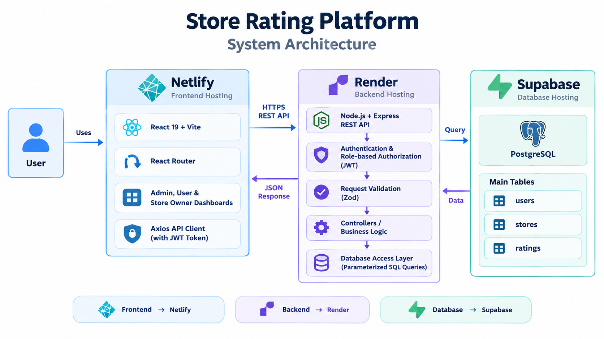
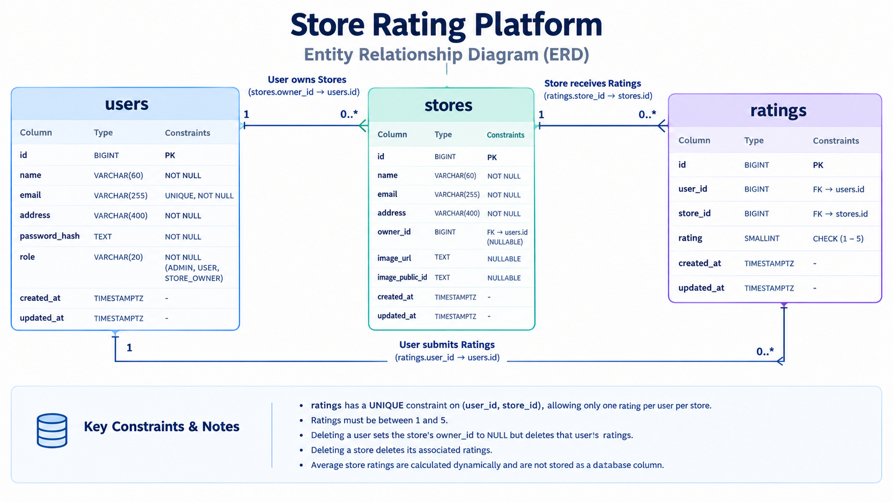

# Store Rating Platform

A full-stack web application where users can discover stores, submit ratings, and manage their reviews. The platform provides separate dashboards for administrators, normal users, and store owners through role-based access control.

**Live Demo:** [Open Application](https://rating-platform.netlify.app/)  
**Backend API:** [API Health Check](https://store-rating-pltform.onrender.com/api/health)

## Table of Contents

- [Features](#features)
- [Tech Stack](#tech-stack)
- [System Architecture](#system-architecture)
- [Database Design](#database-design)
- [Security and Validation](#security-and-validation)
- [Getting Started](#getting-started)
- [API Overview](#api-overview)
- [Testing and Build](#testing-and-build)
- [Deployment](#deployment)
- [Project Structure](#project-structure)
- [Future Improvements](#future-improvements)

## Features

### System Administrator

- Dashboard with total users, stores, and submitted ratings.
- Create users with different roles and register stores.
- Assign store owners to stores.
- Search, filter, sort, and paginate user and store listings.
- View user details and store ratings.

### Normal User

- Register and log in securely.
- Browse stores and search by name or address.
- View overall store ratings and submit ratings from 1 to 5.
- Update a previously submitted rating.
- View profile details and change password.

### Store Owner

- View owned stores and their average ratings.
- Track the number of ratings received.
- View customer ratings and reviewer details.
- Sort the ratings table and change password.

## Tech Stack

| Layer | Technologies |
|---|---|
| Frontend | React 19, Vite, React Router |
| Styling | Tailwind CSS 4, CSS variables |
| Backend | Node.js, Express 5 |
| Database | PostgreSQL, Supabase |
| Authentication | JWT, bcrypt |
| Validation | Zod |
| API Client | Axios |
| Testing | Node.js Test Runner |
| Code Quality | oxlint |
| Deployment | Netlify, Render |

## System Architecture

The application follows a three-tier architecture. The React frontend communicates with the Express REST API over HTTPS. The backend authenticates requests, validates input, applies role-based authorization, and interacts with PostgreSQL through parameterized SQL queries.



### Request and Response Flow

1. Users interact with the React frontend hosted on Netlify.
2. The frontend sends HTTPS REST API requests with a JWT when authentication is required.
3. The Express backend hosted on Render authenticates and validates requests.
4. Controllers and business logic execute the requested operations.
5. The database access layer communicates with Supabase PostgreSQL.
6. The backend returns a JSON response to the frontend.

## Database Design

The database uses PostgreSQL and consists of three primary tables:

- **`users`** — stores user details, password hashes, and roles.
- **`stores`** — stores store information and optional owner assignments.
- **`ratings`** — stores ratings associated with users and stores.

### Entity Relationship Diagram (ERD)

The following diagram illustrates the database tables, primary keys, foreign keys, and relationships.



### Database Constraints

- User email addresses are unique.
- Ratings must be between 1 and 5.
- A unique constraint on `ratings(user_id, store_id)` allows one rating per user per store.
- `stores.owner_id` references `users.id` and can be NULL.
- Deleting a user sets their stores' `owner_id` to NULL and deletes their ratings.
- Deleting a store deletes its associated ratings.
- Average store ratings are calculated dynamically and are not stored as a database column.

## Security and Validation

- Passwords are hashed using bcrypt before storage.
- JWTs protect authenticated API endpoints.
- Role-based authorization restricts access to administrative and store-owner functionality.
- Zod validates request data.
- Parameterized SQL queries help prevent SQL injection.
- Database constraints enforce important data-integrity rules.
- Password hashes and sensitive implementation details are excluded from API responses.
- CORS, Helmet security headers, and request body-size limits are configured.

### Input Validation

| Field | Requirement |
|---|---|
| Name | 20–60 characters |
| Address | Maximum 400 characters |
| Password | 8–16 characters, at least one uppercase letter and one special character |
| Email | Valid email format |
| Rating | Integer from 1 to 5 |

## Getting Started

### Prerequisites

- Node.js and npm
- A PostgreSQL database
- Git

### 1. Clone the Repository

```bash
git clone https://github.com/Chaitanyaraut027/store-rating-pltform.git
cd store-rating-pltform
```

### 2. Configure the Backend

```bash
cd server
npm install
```

Create `server/.env` with the following configuration:

```env
NODE_ENV=development
PORT=5000
CLIENT_URL=http://localhost:5173
DATABASE_URL=your_postgresql_connection_string
JWT_SECRET=your_secure_random_secret
JWT_EXPIRES_IN=7d
```

Apply the SQL schema from `database/migrations/001_initial_schema.sql` to your PostgreSQL database before starting the backend.

### 3. Configure the Frontend

Open another terminal at the project root, then run:

```bash
cd client
npm install
```

Create `client/.env`:

```env
VITE_API_BASE_URL=http://localhost:5000/api
```

### 4. Run the Application

Start the backend:

```bash
cd server
npm run dev
```

Start the frontend in a separate terminal:

```bash
cd client
npm run dev
```

Open [http://localhost:5173](http://localhost:5173) in your browser.

## API Overview

The backend exposes REST endpoints under `/api`.

| Method | Endpoint | Purpose |
|---|---|---|
| GET | `/api/health` | Check API health |
| POST | `/api/auth/register` | Register a normal user |
| POST | `/api/auth/login` | Log in |
| GET | `/api/auth/me` | Get the authenticated user |
| PATCH | `/api/auth/change-password` | Change password |
| GET | `/api/admin/dashboard` | Get administrator statistics |
| GET | `/api/admin/users` | List and filter users |
| POST | `/api/admin/users` | Create a user |
| GET | `/api/admin/stores` | List and filter stores |
| POST | `/api/admin/stores` | Create a store |
| GET | `/api/user/stores` | Browse stores and ratings |
| POST | `/api/ratings` | Submit or update a rating |
| GET | `/api/owner/dashboard` | View store-owner dashboard |
| GET | `/api/owner/ratings` | View customer ratings |

Protected endpoints require a JWT bearer token and, where applicable, the appropriate user role.

## Testing and Build

Run backend tests:

```bash
cd server
npm test
```

Run the frontend linter:

```bash
cd client
npm run lint
```

Create a production frontend build from the client directory:

```bash
npm run build
```

## Deployment

| Component | Hosting Service |
|---|---|
| Frontend | Netlify |
| Backend | Render |
| Database | Supabase PostgreSQL |

Configure production environment variables in the respective hosting dashboards. The frontend API URL must point to the deployed backend API, and the backend CORS configuration must allow the deployed frontend origin.

## Project Structure

```text
store-rating-platfrom/
├── README.md
├── docs/
│   ├── architecture.png
│   └── er-diagram.png
├── client/
│   └── src/
│       ├── components/
│       ├── context/
│       ├── layouts/
│       ├── pages/
│       ├── routes/
│       ├── services/
│       └── styles/
├── server/
│   ├── src/
│   │   ├── config/
│   │   ├── controllers/
│   │   ├── middleware/
│   │   ├── models/
│   │   ├── routes/
│   │   └── validators/
│   ├── tests/
│   └── package.json
└── database/
    └── migrations/
        └── 001_initial_schema.sql
```

## Future Improvements

- Add rate limiting to authentication endpoints.
- Improve the rating update experience by ensuring existing ratings are preselected in the frontend.
- Add automated end-to-end tests for complete user workflows.
- Implement store image uploads.

---

**Built as a full-stack development project** to practice REST API design, relational database modeling, authentication, role-based access control, and frontend-backend integration.
